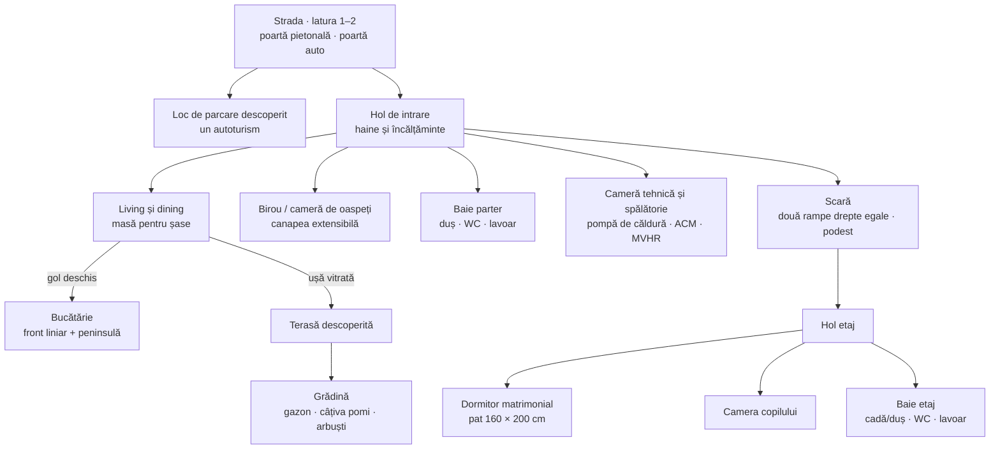

# Diagrama intențiilor pentru casă

Aceasta este o reprezentare compactă a relațiilor obligatorii dintre încăperi din tema demonstrativă. Nu este un plan, o
geometrie cotată, o orientare cardinală sau un proiect aprobat. Arhitectul poate oglindi sau roti organizarea pentru
terenul real, păstrând topologia consemnată în [`brief/architecture.md`](brief/architecture.md) (`LAY-01`).

Casa demonstrativă este P+1, fără subsol, cu amprentă de concept de circa 10,0 × 8,0 m și un plafon de 180 m²
construiți desfășurați, inclusiv finisajele. Parcela fictivă are circa 24 × 40 m (circa 960 m²); conceptul păstrează
minimum 2 m față de toate limitele pentru casă, terasă și proiecțiile acoperișului. Orientarea și geometria reală se
stabilesc după ridicarea topografică și certificatul de urbanism.
